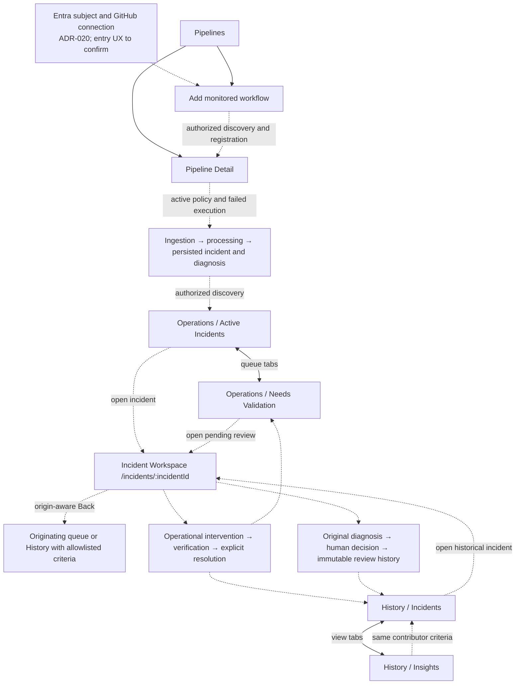

# Paper product UX reconciliation

Observed 2026-11-19. This companion to the [frontend functional map](frontend-functional-map.md) records design evidence and proposes a delivery sequence. D01–D07 and the accepted architecture decisions continue to govern their respective boundaries. The pre-Workspace comparison baseline was frontend `main` at `d398af3`. The separate Operations replay is draft [PR #23](https://github.com/pipesor-org/pipesor-frontend/pull/23) at `16fe60b`.

## Paper MCP access and evidence

The WSL Codex CLI's `codex mcp get paper` showed one enabled Streamable HTTP endpoint at `http://127.0.0.1:29979/mcp`. No remote Paper or stdio entry was configured. The sandboxed request could not connect. Outside the sandbox, WSL reported mirrored networking, Windows reported a running Paper process and a reachable listener, and the same WSL URL completed MCP initialization with `paper-desktop 0.5.19`. The inspection used the configured endpoint directly from the WSL shell because the active tool list did not expose Paper. This verifies endpoint and document access; a fresh Codex session's tool discovery was outside the check.

Using the Paper guide and then `get_basic_info`, the open file was **Pipesor**, with one page, **Page 1**, 2,285 nodes and ten artboards. `get_jsx` returned all ten artboards. A `get_screenshot` capture of the resolved Workspace confirmed the hierarchy and the visible default validation state. No config or Paper changes were needed. If a later Codex session lacks the tools, open the same file in Paper Desktop and start a fresh CLI session. If Windows can reach the listener and WSL cannot, check mirrored networking and the agent sandbox before touching the MCP entry. Paper's optional stdio migration is a replacement for the existing entry. [Paper MCP guide](https://paper.design/docs/mcp) · [Pipesor — Page 1](https://app.paper.design/file/01M3SGMN2N9NPNEKH3TMXGBZG2/p-1-0)

## Verified frame-to-source inventory

Widths are 1440 px. Heights are rounded to the nearest pixel. Action labels, descriptions and visible states establish the intended presentation. The exported JSX contained no wired links or click handlers for these controls.

| Paper frame and identifier | Height | Observed design content and interaction cues | Pre-Workspace frontend baseline and reuse |
| --- | ---: | --- | --- |
| Operations — Active Incidents (`1-0`) | 900 | Active/Needs Validation tabs, severity and analyzing counts, Mine/Unassigned/All, search and facets, severity/elapsed order cue, diagnosis and assignment cells. “Select a row to open its Incident Workspace.” | [OperationsPage](../../src/pages/operations/ui/OperationsPage.tsx), `OperationsTabs`, `OperationsSummary`, `IncidentFilters`, `IncidentsTable`. Tab navigation works. Incident data are fixtures; rows, filter/sort and assignment affordances have no product connection. |
| Operations — Needs Validation (`1KV-0`) | 900 | Pending count, oldest pending, resolved-date facet, sort menu alternatives, proposed diagnosis, resolved/pending duration, Pending badge, and an empty-state variant. Rows lead to Workspace for review. | Same Operations composition with `NeedsValidationTable`; fixture membership is resolved plus pending. PR #23 embeds the P3 replay panel under an explicit review query. That URL is a local harness entry and does not establish incident discovery. |
| Incident Workspace — INC-1039 (`91-0`) | 1170 | Back to Operations; Open status and assignee; original run; AIOps inference and probable cause; Observed evidence with three time/stage-tagged snippets, View context and full event timeline; Recommended action with PR and run links and Start remediation. Right rail has Incident details, Ownership, Timing and Timeline. | Workspace absent. Reuse `AppLayout`, `AppSidebar`, incident status/stage UI and formatters. The local diagnostic panel supplies evidence/diagnosis rendering behavior to adapt. |
| Incident Workspace — Verification — INC-1039 (`16D-0`) | 1395 | Same hierarchy, with Remediation completed, Verification run #1843 / Success, and Resolve incident. The frame explicitly says diagnosis validation remains pending. | Workspace variant absent. Pipeline implements transition and incident-run contracts; the product exposes neither. |
| Incident Workspace — Resolved / Diagnosis Validation (`1CW-0`) | 1599 | Preserved original inference/evidence, remediation and successful verification, resolved actor, then Diagnosis validation. Default capture shows Confirm diagnosis and Reject diagnosis. The exported tree also contains a rejection form with required Actual cause, optional Additional notes, Cancel and Submit rejection. | Workspace variant absent. `DiagnosticReview` (since removed) implements local P3 decisions and immutable history; the Paper rejection form and P3 are semantically different. |
| History v1 — Resolved incidents (`FF-0`) | 900 | Search and five facets, newest resolved cue, outcome and duration columns, row instruction to open Workspace in historical view. | [HistoryPage](../../src/pages/history/ui/HistoryPage.tsx), `HistoryTabs`, `IncidentFilters`, `HistoryIncidentsTable`. Current fixture projection is terminal-review-only; D03 target includes every resolved incident. No row navigation. |
| History — Insights v1 (`OC-0`) | 1316 | Date/repository/pipeline/stage/severity controls, mean diagnosis time, MTTR, diagnosis confirmation rate and resolved count; trend, stage and outcome views; recurring pipeline/stage groups link conceptually to filtered Incidents. | `HistoryInsightsFilters` and `HistoryInsights` render a fixed-window fixture analysis. Filters and recurring-group drill-down are unconnected. D05 defines the contributor-preserving target. |
| Pipelines — Monitored workflows (`V4-0`) | 900 | Add monitored workflow, search, Criticality / Responsible team / Monitoring filters, inventory rows with repository and environment; choose a workflow to configure it. | [PipelinesPage](../../src/pages/pipelines/ui/PipelinesPage.tsx) provides working fixture search, filters and links to detail and onboarding. |
| Pipeline Detail — deploy-production (`120-0`) | 1445 | Connected provider context plus Identity, Operational policy, Ownership, Access and Last configuration update. Repository and workflow links, Active/Paused, Edit ownership, and View configuration history. | [PipelineDetailPage](../../src/pages/pipeline-detail/ui/PipelineDetailPage.tsx) and existing detail sections provide a fixture-based read view. Save, effective connection/grants and activity reads are unconnected. |
| Pipelines — Add monitored workflow (`1TV-0`) | 1659 | GitHub workflow → Operational policy → Ownership → Review and add. Connected status and read-only copy; repository/workflow selection, file/default branch/provider, criticality, environment, monitoring, responsible team and named owners. Tree includes select-first, duplicate, loading, retry and unavailable variants. | [AddMonitoredWorkflowPage](../../src/pages/add-monitored-workflow/ui/AddMonitoredWorkflowPage.tsx) has a synthetic catalog, local draft, validation, preview and discard. Provider discovery and durable registration are unconnected. |

All artboards share the AIOps sidebar with Operations, History, Pipelines and the Maya Patel / DevOps / SRE profile footer. The ten frames show connected context but contain no standalone GitHub connection, callback, recovery, or profile settings screen. The current [UserMenu](../../src/widgets/app-sidebar/ui/UserMenu.tsx) supplies locale/theme controls and a fixture identity. An authenticated GitHub connection entry and recovery presentation need product confirmation within the existing flow.

The file reports Sora and JetBrains Mono and an empty token collection. Representative inline design values are a 200 px white sidebar, `#F7F8FA` canvas, `#17191C` main text, `#667085` muted text, `#E4E7EC` borders and `#3157D5` action accent. The Workspace places the incident header above a primary evidence/action column and a compact context rail. Use the app's [semantic tokens](../../src/app/styles/tokens.css), responsive shell and EN/ES conventions when implementing; Paper supplies a desktop composition. The inspected page does not establish mobile behavior, production copy, or the underlying event chronology. The INC-1039 snapshots have inconsistent elapsed times. Use coherent persisted timestamps and genuine GitHub references.

## Workspace implementation mapping

[IncidentWorkspaceRoute](../../src/pages/incident-workspace/ui/IncidentWorkspaceRoute.tsx) implements the shared Paper destination at `/incidents/:incidentId` with the incident UUID. It reads Pipeline (incident, runs, executions, pipeline) and Recommendation (diagnosis) and keeps the origin-aware Back link (D02).

| Paper element | Implementation | Deviation and reason |
| --- | --- | --- |
| `INC-1039 · acme/web-storefront` title | `repo · Run #<runId>`; `INC-<displayNumber>` (or abbreviated UUID) in the subtitle and rail | Agreed: run identity is the stable reference; display number is presentation only |
| Assigned to / Ownership Change / Assignee column | Responsible team snapshot only | No assignment contract |
| `88% confidence` | Omitted | The model returns no confidence |
| Observed evidence with timestamps | `Stage · job file · lines a–b` from the v2 locator; full sanitized excerpt behind View context; "Cited by the diagnosis" tag | Locator, not log timestamps, is the provenance |
| — | Retrieved knowledge (RAG) section | Added so inferred, observed and retrieved content stay distinct |
| Related change, View pull request, View full event timeline | Omitted | No PR or event-timeline data |
| View run in GitHub / Run / Commit links | Built from repository, run id and attempt / commit SHA | Agreed construction |
| Timing and Timeline | Detected, diagnosis ready, remediation/verification started, resolved — only recorded timestamps | No synthetic events |
| Start remediation, Verification, Resolve | One "Remediation and verification" section: Start remediation → choose the successful verification run → Resolve incident | Paper shows a static verification run; the operator now chooses it, since only a captured run can be linked |
| Diagnosis validation (Confirm / Reject form) | Confirm opens a short panel with optional notes; Reject requires actual cause | Confirm asks for one more click to allow a note and avoid accidental confirmation |

## Interaction and navigation

Solid arrows are existing browser navigation, currently on fixtures where applicable. Dashed arrows represent design/functional intent or a runtime dependency. The three Workspace artboards are presentations of one incident route under D01. Origin-aware Back follows D02 even when resolution changes queue membership.

The durable monitored pipeline identifies a registered workflow and its policy. An incident represents an operational failure associated with that pipeline and specific runs. Workflow criticality differs from incident severity. Pipeline ownership differs from incident assignment. A successful verification run is evidence for explicit resolution; the reviewer decision remains independent. Under D03, resolved/pending belongs to both History and Needs Validation. For Insights, preserve D04/D05 criteria and cohort semantics, and settle how corrected reviews contribute before expanding the current Confirmed/Rejected denominator.

## Action-to-contract matrix

Paths below are implemented boundaries unless explicitly described as pending. Pipeline REST paths use the `/api/v1` prefix. ADR-020 keeps GitHub tokens in Ingestion and requires current GitHub eligibility plus effective AIOps capability, with authorization before pagination. Rendered names, IDs, Paper labels and the replay credential confer no product permissions. Backend baselines match the [previous runtime evidence in PR #23](https://github.com/pipesor-org/pipesor-frontend/pull/23). See [ADR-020](https://github.com/pipesor-org/pipesor-docs/blob/main/docs/architecture/decisions/ADR-020-github-user-access-and-workflow-onboarding.md) and [pending decisions](https://github.com/pipesor-org/pipesor-docs/blob/main/docs/architecture/pending-decisions.md).

| User action / event | Owner and existing contract | Classification and remaining dependency |
| --- | --- | --- |
| Navigate modules, search fixture inventory, open fixture detail/draft, switch locale/theme | React routes and local preferences. Pipeline and incident fixtures are separately Zod-validated. | **Implemented and connected locally.** Product data remain fixtures. Preserve responsive behavior and FSD imports. |
| Identify user, connect/disconnect GitHub, show Connected or recovery | Entra represents the user. Ingestion `GET/DELETE /api/v1/github/connection` covers status/disconnect. Browser initiation/callback execution needs state, PKCE, identity binding, admitted installation and custody/refresh runtime. | **Blocked by auth/runtime and product UX.** Decide the entry placement and connection/recovery states. |
| Choose repository/workflow and load metadata | Ingestion `GET /api/v1/github/repositories` and `GET /api/v1/github/repositories/{repositoryId}/workflows`. Valid delegated user, GitHub link and current admitted read access. | **Visual with fixtures; backend implemented, unexposed.** Bind provider choices and error states after session/callback activation. |
| Register, browse and inspect monitoring | Pipeline `POST/GET /pipelines`, `GET /pipelines/{id}`. Registration accepts selected provider IDs, criticality and monitoring status plus optional environment/team fields. Internal Ingestion workflow verification rechecks repository administration and metadata. Pipeline creates initial CONFIGURE and returns conflict on duplicates. List/detail use current GitHub read and VIEW. | **Backend implemented, unexposed.** Map approved DTOs to inventory, draft and detail. Fixture pipeline UUID and workflow path validation are presentation only; provider IDs drive registration. |
| Configure policy/team and inspect access/activity | Pipeline policy, ownership and settings PUTs; grants and activities GETs under the item. CONFIGURE plus GitHub administration governs configuration; CONFIGURE includes VIEW and does not imply OPERATE. Ownership accepts team reference and name snapshot, with nullable fields. | **Backend implemented, unexposed for supported fields.** The named Pipeline owners list, team-required design and group-like Access labels cannot be mapped directly to current resource/grant contracts. Settle supported fields and subject representation. |
| Receive failed execution and persist incident | Ingestion's signed `POST /webhooks/v1/github/workflow-runs`, capture/protection/publication and Service Bus; Pipeline execution snapshot consumer and PostgreSQL ops records. Log/Event, NLP, Correlation, RAG and Recommendation build the diagnosis through scoped owner boundaries. | **Partially integrated through a local harness.** Synthetic E02 starts from protected evidence and calls the Pipeline snapshot handler with a synthetic failure. The run exercises durable processing and diagnosis, with no live webhook or broker delivery. |
| Discover an incident in Active/Needs Validation/History and open it | Pipeline lists per pipeline via `GET /pipelines/{id}/incidents`; `GET /incidents/{id}` and `GET /incidents/{id}/runs` require effective VIEW with current repository access. Pipeline uses a UUID; display labels like INC-1039 are Paper/fixture identifiers. | **Queue UI uses fixtures; item backend implemented, unexposed.** Need an approved cross-pipeline scoped read/query and diagnostic-review projection. Define durable route identity, display ID, safe fallback and unavailable/denied handling. |
| Inspect context, run links, evidence, inference and recommendation | Pipeline owns operational runs/status/history facts; Log/Event owns protected evidence; Recommendation owns original snapshot and scoped RAG citation references. Existing machine checks are separate from human reads. | **Partially integrated through P3; human access contract blocked.** Need authorized incident-to-diagnostic/version lookup and response mapping, including masking and evidence reference checks. Supply timeline, GitHub links and confidence only when supported by authorized records. |
| Assign incident / Start remediation / verify / resolve | Pipeline exposes `POST /incidents/{id}/remediation`, `/verification`, `/retry-remediation`, `/resolve` with current access, OPERATE and lifecycle checks; verification and resolution take execution IDs. | **Transitions implemented in backend, unexposed.** No assignment command found in this controller; settle eligibility and assignment separately. GitHub reads/links support manual action, and Pipesor records it. |
| Confirm, correct or reject and read immutable reviews | Recommendation P3 test-only `GET/POST /local-demo/v1/diagnoses/{id}/review` serves original output and persisted history with scoped per-run authorization and revision/idempotency controls. | **Partially integrated through a local harness.** Product read/write authority and review eligibility need approval. Paper rejects with actual cause; P3 puts actual cause and optional revised recommendation under CORRECTED, with REJECTED and justification distinct. Approve the mapping and status/metric treatment before using the form in Workspace. |
| Read historical decisions and drill into Insights | Incident selectors and Insights widget aggregate fixtures. D03/D04/D05 specify target local cohorts and query behavior. | **Visual with fixtures; drill-down unimplemented.** Require authorized pagination/aggregate sources, stable contributor keys and review-outcome semantics for product history. |

The incident fixture schema requires `INC-<digits>` and has a display diagnosis plus optional note. The monitored pipeline schema has a distinct branded UUID, workflow display metadata, policy and named ownership. The P3 schema validates a structured diagnosis and versioned history independently. Introduce contract-specific boundary mapping when approved. Preserve the existing entity and widget public APIs, and share the reusable review renderer and Zod contract from an appropriate lower FSD layer when Workspace is implemented.

## Workspace verification and remaining pilot boundary

The fixture Workspace, the local P3 replay and their Chromium verifiers (`verify_incident_workspace.cjs`, `verify_local_diagnostic.cjs`, `verify_local_review.cjs`) were removed when Operations and the Workspace were integrated with Pipeline and Recommendation. Verification is now a browser walkthrough against the local stack with a real GitHub session, recorded in each Pull Request. The registration pilot (`verify_workflow_registration.cjs`, `PIPESOR_DEMO_*` proxy) remains until Pipelines is integrated.

## Staged proposal and decision gates

1. **Make the existing incident journey navigable first.** With scoped approval, implement D01/D02/D06 as a read-only Workspace entered from Active Incidents, Needs Validation and History, using clearly isolated coherent fixtures or a test-authorized replay projection. Reuse the existing tables and layout. Demonstrate one incident across its operational states with origin-aware return. Settle direct-entry fallback, durable/display ID mapping, missing diagnosis/evidence presentation and which timeline/links can be shown. Keep the existing demo paths transitional.
2. **Demonstrate replay through the actual Workspace.** Agree with the contract owners on a scoped incident-to-diagnosis lookup, current subject authorization for incident/evidence/review, review eligibility and Paper-to-P3 outcome semantics. Then reuse the existing P3 state machine, persistence and immutable history in the Workspace's Diagnosis validation section. Preserve Observed evidence, AIOps inference, Recommended action and operational Verification as distinct content. Verify scoped denial, stale writes, reload and backend restart. Keep Needs Validation a queue.
3. **Connect the existing workflow journey.** Confirm connection entry and states in the current shell/onboarding flow, and settle ADR-020 runtime subject propagation, callback, custody and installation inputs under PD-027/034/035. Bind the existing workflow chooser and registration, then inventory/detail settings and effective access. Demonstrate authorized workflow → policy/ownership → clearly labeled controlled failure → incident discovery → Workspace → review → History. Represent only supported ownership fields. Until connection is available, show the seeded test workflow as a seeded workflow.
4. **Complete durable discovery and history, then expand collection.** Agree on the limited authorized cross-pipeline queue/read projection needed for the demo before adding aggregate scope. Apply D03–D05, including matching drill-down contributors and settled correction/confirmation denominators. Live signed webhook, capture and broker verification remain separately gated on configured authorities and runtime delivery. Assignment and operational transitions require their own action rules and UI verification.

For advisor evidence, deterministic E02 is the reproducible local path with durable processing and real PostgreSQL/pgvector retrieval using test embeddings. Separate earlier Foundry checks exercised real GPT-4o and managed embeddings in a local harness. Those checks establish neither diagnostic effectiveness nor live GitHub ingestion. This reconciliation executed no inference. [Owner-chain runbook](https://github.com/pipesor-org/pipesor-evidence-correlation-engine/blob/main/docs/local-diagnostic-demo.md)
